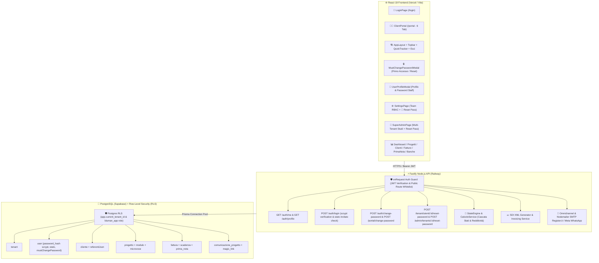

# 🏛 BluMan Advisory Platform — Architettura & Guida Produzione

Piattaforma ERP per studi di consulenza societaria, wealth protection ed advisory. Integrazione end-to-end con **React 19 + Fastify + Prisma + PostgreSQL (Supabase)**.

> 🤖 **Devi passare ad un altro PC?** Apri ed incolla il testo di **[`ISTRUZIONI_PER_IA.md`](file:///Users/mariodibenedetto/Downloads/bluman-api/ISTRUZIONI_PER_IA.md)** nella nuova IA per riprendere il lavoro in 1 secondo!  
> 🗺️ **Piano di Sviluppo & Roadmap**: Consulta il documento completo **[`PIANO_SVILUPPO_COMPLETO.md`](file:///Volumes/Macintosh%20HD/Users/mariodibenedetto/Downloads/bluman-api/PIANO_SVILUPPO_COMPLETO.md)** per la scaletta dettagliata di tutte le funzionalità e ottimizzazioni pianificate.

---

## 🗺️ Mappa & Grafo Architetturale della Piattaforma



---

## 🎯 Stato del Progetto & Componenti Verificati

### 🧑‍💼 Portale Cliente Passwordless (6 Schede)
- **Firma Engagement Letter**: Firma 1-click del preventivo d'ordine e della lettera di incarico con sigillo eIDAS.
- **Avanzamento Live Lavori**: Timeline delle fasi di consulenza in corso con percentuale globale e moduli/micro-voci filtrati dinamicamente in base al progetto selezionato.
- **Form Dati Societari**: Compilazione guidata dei dati fiscali, IBAN, legale rappresentante e UBO.
- **Vault Documenti**: Archivio contratti, delibere ed allegati firmati.
- **Live Chat & Contatti Advisor**: Chat bidirezionale interattiva con l'Advisor collegata via API Fastify e salvata su PostgreSQL.
- **👤 Profilo & Password**: Modifica dati anagrafici, recapiti telefonici e aggiornamento password personale.

### 🔒 Sicurezza Password al Primo Accesso & Reset Admin (§23, §27)
- **Cambio Password Obbligatorio**: Al primo accesso o in caso di reset, l'utente con `stato: 'invitato'` visualizza il modale non chiudibile `MustChangePasswordModal` che impone la scelta di una nuova password permanente (min. 8 caratteri con calcolo dinamico di robustezza conforme ISO/IEC 27001).
- **Cifratura Scrypt**: Le password non sono mai salvate in chiaro ma protette da algoritmi di hash a prova di quantum/GPU brute-force.
- **Pulsante `🔄 Reset Pass` in Gestione Team & Multi-Tenant**: Lead Advisor e Super Admin possono rigenerare istantaneamente una password provvisoria monouso per qualsiasi collaboratore o responsabile di studio.

### 📋 Anagrafica Master Cliente ERP (4 Schede & Persistenza Totale)
- **Dati Legali**: Ragione Sociale, Partita IVA / VAT, Codice Fiscale, Giurisdizione, REA, Capitale Sociale.
- **Sedi Distinte**: Sede Legale (Indirizzo, Città, CAP, Nazione) e Sede Operativa / Rappresentanza disaccoppiate.
- **Fatturazione SDI**: Codice Destinatario 7 caratteri (es. `SUBM70N`), Regime Fiscale ed IBAN cliente.
- **Compliance KYC/AML**: Classe di rischio antiriciclaggio, Titolare Effettivo (UBO), origine patrimoniale e data rinnovo KYC.
- **Salvataggio Bidirezionale**: Persistenza sincrona su PostgreSQL (`prisma.cliente` + `referentiJson`) e fallback in locale.

### 📥 Prima Nota & Riconciliazione Estratto Conto Bancario (CSV)
- **Import Estratto Conto (CSV)**: Parsing automatico di righe CSV bancarie (`Data, Causale, Importo, CRO/TRN`).
- **Smart Reconciliation**: Riconciliazione automatica con le anagrafiche dei clienti e le fatture dello studio.
- **Registro Movimenti**: Tracciamento contabile per metodo di pagamento (Bonifico, POS, Stripe, Assegno) e codice CRO/TRN.

### 💶 Fatturazione & Note di Credito (Numerazione Sequenziale Distinta)
- **Fatture VENDITA (Serie `FT`)**: Numerazione autonoma (es. `FT-2026/001`).
- **Note di Credito (Serie `NC`)**: Numerazione autonoma (es. `NC-2026/001`) con causale di storno e riferimento fattura originale.
- **Tracciato SDI Comped Servizi FPA**: Generazione ed associazione XML FatturaPA.
- **Configuratore Layout PDF (Admin)**: Upload Logo Studio, colore tema e note legali in piè di pagina con anteprima live.
- **Gestionale Fatture (`/invoices`)**: Dashboard globale per il controllo pagamenti, scadenziario e filtri stato.

### 🗄 Archiviazione & Eliminazione Sicura
- **Blocco Fiscale**: Impossibile eliminare un progetto se sono state emesse Fatture/Note di Credito.
- **Doppio Controllo**: L'eliminazione definitiva richiede la digitazione manuale del nome progetto.

### 🕸 Grafo & Dipendenze Moduli nel Progetto
- **Visual Flow Topologico & Frecce SVG**: Layout a 3 colonne (*Punto di partenza*, *Sbloccati a cascata*, *Dipendenti*) con connettori direzionali SVG viola.
- **🔒 Lucchetti Topologici Dinamici & Notifica Sblocco Cliente**: Visualizzazione dello stato `🔒 Locked` / `🔓 Unlocked` sulle dipendenze e pulsante `✉️ Notifica Sblocco al Cliente` al completamento delle fasi.
- **Associazione Giurisdizioni**: Menù a tendina `🌍 Giurisdizione Target *` nel costruttore di moduli ed articoli per Malta 🇲🇹, Gibilterra 🇬🇮, USA 🇺🇸, EAU 🇦🇪.
- **Assegnazione 1-Click a Cliente & Smart Anti-Duplicazione**: Pulsante `🚀 Assegna a Progetto Cliente` direttamente dalle card del Grafo con scansione automatica per evitare la duplicazione di articoli o lavoro già svolto (0h per doppioni).
- **Upselling Moduli**: Pulsante `+ Aggiungi Modulo da Libreria` anche all'interno della scheda del progetto del cliente.

### ⏱️ Quick Time Tracker Fluttuante nella Topbar (Stopwatch 1-Click)
- **Timer Digitale Live**: Avvio, pausa e stop sessione di lavoro sempre a portata di mano nella barra superiore.
- **Selettore Pratica Rapido**: Caricamento dinamico di tutte le pratiche dal DB/local con selezione della microvoce.
- **Calcolo Costo Lavoro Reale**: Calcolo automatico della spesa lavoro in base alla tariffa oraria specifica dell'operatore (es. 120€/h, 95€/h, 90€/h, 85€/h, 45€/h) e consuntivazione immediata a database.

### 📦 Export Fascicolo Digitale Completo ZIP in 1-Click
- **Archivio Strutturato Zero-Dependency**: Compressione client-side di tutti gli atti del progetto in cartelle ordinate (`/01_Contratti_e_Incarico`, `/02_Societario_e_Delibere`, `/03_KYC_Compliance_e_Visure`, `/04_Fatture_e_Ricevute`).
- **Indice Conforme eIDAS**: Generazione automatica del file `INDICE_FASCICOLO.txt` con metadati, cliente, valore e marcatura temporale ISO UTC.

### 📊 Export Contabile Commercialista (CSV / Excel)
- **Prima Nota & Registro Fatture**: Download 1-click in formato CSV UTF-8 con BOM per la massima compatibilità con i gestionali fiscali (**Zucchetti, TeamSystem, Datev, Profis ed Excel**).

### 📲 Notifiche Push Desktop Native del Browser
- **Centro Notifiche Integrato**: Richiesta permessi push al browser (`Notification.requestPermission()`) con test istantaneo e ricezione avvisi live su scadenze, firme FEA e ritardi.

### 📊 Redditività Incarico & Controllo Budget Commessa Live
- **KPI Finanziari Live**: Margine Lordo Studio (€ e %), Resa Oraria Effettiva Studio (€/ora), Ore Stimate vs Consuntivate Reali.
- **Barra Progressiva Consumo Budget**: Semaforo visivo intelligente (🟢 Ottimale >50%, 🟡 In Linea 20-50%, 🔴 Allerta Sforamento <20%).
- **Ripartizione Lavoro Team**: Tabella dettagliata con ore registrate e costi effettivi per ogni singolo professionista dello studio.
- **📄 Export Rendiconto Economico CSV / PDF**: Esportazione immediata del prospetto trasparenza per lo studio o il cliente.

### 📈 Avanzamento Calcolato dal Motore di Stato (§16)
- **Le percentuali non sono più inventate dal frontend**. `Dashboard` assegnava `45%` a ogni progetto in corso, `10%` a ogni altro e `50%` a ogni modulo `in_progress`; la barra di `ProjectDetail` leggeva `percentualeAvanzamento`, un campo che il backend non ha mai prodotto — quindi era ferma a zero. Ora `GET /progetti` e `GET /progetti/:id` restituiscono `avanzamento` (stato, percentuale, segnale di rischio, ore extra) per progetto **e per singolo modulo**, calcolato dalle ore effettivamente consuntivate.
- **Il calcolo vive solo sul backend**: `src/services/calcoloService.ts` chiama le funzioni pure di `src/domain/stateEngine.ts`. Il dominio non finisce nel bundle pubblico e non esistono due implementazioni da tenere d'accordo.
- **`POST /progetti/:id/ricalcola`**: riallinea le righe dopo un'importazione, una correzione fatta a mano a database o un cambio di regole. Scrive solo dove il valore calcolato differisce da quello in riga — un ricalcolo che riscrive valori identici sporcherebbe `updatedAt` e renderebbe indistinguibile "lo stato è cambiato" da "qualcuno ha premuto ricalcola".
- **Le percentuali non sono una colonna**: derivano da `stato`, `orePreventivate` e `oreConsuntivate`, già in riga. Persisterle significherebbe tenere un dato che può divergere dai propri ingredienti senza che nessuno se ne accorga. Si persistono solo gli stati e i segnali di rischio, che una query non può ricostruire.
- **Cosa vedere prima di scrivere**: `npx tsx src/scripts/probeAvanzamento.ts` — sola lettura, elenca esattamente quali righe un ricalcolo cambierebbe.
- **Gli avvisi dicono *quale* problema è**: il banner della Dashboard tiene separati il ritardo (stato `delayed`/`blocked`) dallo sforamento di ore (`⚠ Ore sforate — +Nh oltre il preventivo`), e il secondo compare anche sull'intestazione del modulo in `ProjectDetail`. Sono due problemi con due rimedi diversi: un ritardo si recupera col calendario, uno sforamento solo rinegoziando o assorbendo il costo. Prima il banner filtrava soltanto i ritardi mentre il contatore contava anche gli sforamenti, quindi un progetto in allarme per sole ore sforate compariva nel conteggio con il titolo sopra l'elenco vuoto.

### 💬 WhatsApp Business Cloud API & Omnichannel Integration (§14)
- **WhatsApp Cloud API Ufficiale (Graph API v21.0)**: Phone ID `1318817114639409`, WABA `1397431142562576`, Token Permanente System User illimitato.
- **Remote MCP Meta DevTools**: Configurato in `~/.gemini/config/mcp_config.json` su `https://mcp.facebook.com/devtools`.
- **Webhooks Bidirezionali**: Connessione verificata sia su Vercel Serverless (`/api/webhooks/communications/whatsapp.ts`) che su Fastify (`/webhooks/communications/whatsapp`).
- **Binding Dinamico Anagrafica ERP**: Scansione del numero mittente su Supabase ed inserimento automatico nella chat del progetto attivo del cliente.
- **Guida Operativa Dettagliata**: Consulta [`GUIDA_META_WHATSAPP_INTEGRAZIONE.md`](file:///Volumes/Macintosh%20HD/Users/mariodibenedetto/Downloads/bluman-api/GUIDA_META_WHATSAPP_INTEGRAZIONE.md).

### ⚡ Performance, Caching & Scalabilità Distribuita (§4.2, §INF-1, §INF-2)
- **Rate Limiting Distribuito su Redis (`src/util/redis.ts`)**: Provisioning database Redis dedicato su Railway (`REDIS_URL`) integrato nativamente con `@fastify/rate-limit`. Supporta scalabilità orizzontale multi-container e fallback aggraziato in-memory per sviluppo/test.
- **Cache Backend Multi-Layer (`src/services/backendCache.ts`)**: Cache memoria di processo + Redis con TTL (60s) per `GET /giurisdizioni`, `GET /moduli`, `GET /articoli`. Abbina invalidazione reattiva sulle mutazioni ed azzera i 4 roundtrip PostgreSQL RLS per ciascuna richiesta.
- **Cache & Deduplicazione Frontend Piattaforma-Wide (`frontend/src/api/cache.ts`)**: Cache in-memory client-side con TTL e deduplicazione delle chiamate HTTP concorrenti (0ms per cambi tab e navigazione tra Dashboard, Progetti, Clienti, Archivio Documentale, Fornitori, Conti Bancari, Retainers e Liquidazione IVA).
- **Indici DB Compositi ad Alte Prestazioni (`prisma/migrations/20260912150000_indici_performance` & `20260912160000_indici_performance_globale`)**: Indici compositi ottimizzati a copertura totale di tutti i moduli ERP: `AuditLog`, `Notifica`, `Progetto`, `MovimentoPrimaNota`, `Cliente`, `Fattura`, `FatturaRiga`, `ScadenzaIncasso`, `Fornitore`, `FatturaRicevuta`, `Documento` e `ContrattoRicorrente`.

### 🛡️ Disaster Recovery, 2FA TOTP & Rotazione Segreti (§5.2, §6.1, §6.2b)
- **Autenticazione a Due Fattori (2FA TOTP RFC 6238) & Ricorda Postazione/IP Fidato**: Algoritmo HMAC-SHA1 nativo con tolleranza clock-skew ±1 step, compatibilità 100% con **Password di Apple (Portachiavi iCloud su iOS/macOS)**, Google Authenticator e 1Password, segreto cifrato con AES-256-GCM nel DB (colonne `totp_abilitato`, `totp_backup_codes` con migrazione `20260913133000_totp_campi_user` e `totp_ip_fidati` con migrazione `20260913150000_totp_ip_fidati`), memorizzazione automatica dell'IP fidato (chiede il TOTP solo la prima volta dallo stesso IP; sui nuovi IP richiede lo Step-2 con `preToken` a 2 minuti), pulsante di reset postazioni fidate e 8 codici di recupero monouso constant-time (`src/util/totp.ts`, `src/routes/auth.ts`, frontend `TabSicurezza.tsx` e `LoginPage.tsx`).
- **Disaster Recovery & Backup Cifrato AES-256-GCM (`src/scripts/runScheduledBackup.ts`)**: Script schedulabile per export cifrato multi-tenant isolato con `contestoTenant.run()`, sanitizzazione delle credenziali e retention a 14 giorni (`npm run backup:scheduled`).
- **Rotazione Chiavi JWT Zero-Downtime (`src/util/jwt.ts`, `docs/rotazione_segreti.md`)**: Supporto dual-key con variabile `JWT_PREVIOUS_SECRETS` per rotazione trasparente delle chiavi crittografiche senza disconnettere gli operatori.

### 👥 Gestione Team & Timesheet Live Operatori (`/settings`)
- **Scheda Performance Operatore 1-Click**: Cliccando su qualsiasi collaboratore (*Francesca Disabato*, *Joe Disabato*, *Avv. Lorenzo Marino*, *Dr. Elena Russo*, *Avv. Mario Dibenedetto*) si apre la scheda analitica con ore consuntivate, incarichi gestiti e diario timesheet live.
- **📧 Server Email SMTP Transazionale & Omnichannel**: Form credenziali SMTP + 4 Pulsanti di Test 1-Click per WhatsApp, Telegram Bot, Signal Daemon ed Email.

---

## 🚨 REGOLE TASSATIVE DI SVILUPPO (MANDATORY DEV RULES)

1. **Isolamento Multi-Tenant (`tenant_id`) & RLS**:
   - I dati tra i vari studi non si mischiano mai. Il filtro applicativo **non basta e non è la difesa**: è RLS che lo è. Nel codice che serve una richiesta HTTP usa `prisma` da `src/util/prismaClient.ts`, mai `new PrismaClient()`; `prismaAmministrativo()` scavalca le policy ed è ammesso solo in script, seed, bootstrap, backup e nella ricerca utente al login.
2. **Migrazioni Versionate, Mai `db push` su Dati Reali**:
   - Lo schema si cambia con `prisma migrate dev` / `prisma migrate deploy`. `prisma db push --accept-data-loss` riallinea il database cancellando in silenzio colonne e tabelle.
3. **Sincronizzazione Schema Database (Prisma & Supabase)**:
   - Ad ogni cambio codice o nuova funzionalità, lo schema `prisma/schema.prisma` ed il database Supabase DEVONO essere istantaneamente aggiornati. Nessun dato viene perso o gestito solo volatile.
4. **Allineamento Documentazione Markdown (`.md`)**:
   - Tutti i file `.md` (`README.md`, `BluMan_piano_di_sviluppo.md`, `ISTRUZIONI_INSTALLAZIONE.md`, `.agents/AGENTS.md`) DEVONO essere tassativamente aggiornati dopo ogni modifica importante.
5. **Mappa Grafo (Graphify)**:
   - Mantenere aggiornato il grafo con `graphify extract . --code-only` e `graphify cluster-only .`.
   - ⚠️ Grafo **STALE**: la CLI non è installata sulla postazione Windows delle correzioni di Fase 0 e 1. Va rigenerato sulla prima postazione che la ha.
6. **Divieto Assoluto di Credenziali in Chiaro**:
   - Nessuna password, token o chiave API reale nel codice versionato o nei file `.md`. Le credenziali dello studio risiedono nella riga `Tenant` del database (`smtpPass`, `imapPass`) e si gestiscono via `PUT /tenant/settings`. Le password delle persone stanno solo come hash scrypt su `user.password_hash`.
   - Vale anche per i ripieghi: un `|| 'password-qualunque'` e un campo password precompilato sono credenziali cablate, perché il valore che l'API annuncia è quello con cui si entra. Presidio: `src/credenziali.test.ts`, che scandisce anche `frontend/src/`, `api/` ed i file `.md` — il bundle frontend è pubblico esattamente come il repository, e un segreto non va trascritto nemmeno per spiegare che è stato rimosso.

Il testo integrale ed autorevole delle regole è in [`.agents/AGENTS.md`](.agents/AGENTS.md).

---

## ⚙️ Guida Avvio Rapido Locale

```bash
# 1. Clona il repository
git clone https://github.com/mariobros1987/bluman.git
cd bluman

# 2. Installa dipendenze (Backend & Frontend)
npm install
cd frontend && npm install && cd ..

# 3. Avvia il Backend Fastify
npx tsx src/index.ts       # Server in ascolto su http://127.0.0.1:3000

# 4. Avvia il Frontend React
cd frontend && npm run dev # Dev Server in ascolto su http://localhost:5173
```

---

## 🔑 Accesso & Gerarchia dei Ruoli

Nessuna credenziale precaricata: non nel codice, non in questi file `.md`, non nel
frontend (§23). Fino alla Fase 0 `src/server.ts` conteneva una tabella di utenti e
password nel sorgente — chiunque leggesse il repository poteva entrare in produzione. Sono
stati rimossi. L'unica fonte di verità è la tabella `user` del database.

| Ruolo | Ambito (§2bis) | Accesso |
| :--- | :--- | :--- |
| 👑 `super_admin` | Gestisce tutto e vede tutti i tenant (`tenant_id` NULL — è l'invariante su cui si appoggia RLS, non un dettaglio); può cambiare studio corrente via `x-tenant-id` | JWT |
| 👨‍💼 `advisor` | Responsabile del **proprio** tenant; crea e gestisce i collaboratori del proprio studio | JWT |
| 👷 `collaboratore_interno` / `collaboratore_esterno` | Appartengono al tenant da cui vengono creati e non ne escono | JWT |
| 🔑 `cliente` | Passwordless: solo Magic Link su `/portal`, mai `/auth/login` | Magic Link |

Primo accesso su un database vuoto: `npm run bootstrap` crea il primo `super_admin` (§27)
e stampa una password temporanea **una sola volta**. Utenti esistenti senza password:
`npm run passwords:assign`. Nuovi collaboratori: li crea il `super_admin` o l'`advisor`
dalla dashboard, e la risposta contiene la password temporanea da consegnare a mano.
Dettagli in `ISTRUZIONI_INSTALLAZIONE.md`.

**La password la emette sempre il server.** Non c'è un campo dove proporne una, non esiste
un valore di ripiego, e la risposta la mostra in chiaro una volta sola: dopo, nel database
c'è solo l'hash scrypt. Se va perduta si rigenera — per il responsabile di uno studio con
`POST /admin/tenants/:id/reset-password`. Una password di default annunciata dall'API
sarebbe comunque una password valida, quindi non ce ne sono.

Il presidio automatico è `src/credenziali.test.ts`: scandisce `src/`, `frontend/src/` e
`api/` e fallisce se una vecchia password cablata, un token finto o un ripiego
`!password ||` ricompare su una riga non commentata.

---

## 🚧 Nessuna Rotta Aperta per Sbaglio (§23)

L'hook `onRequest` di `src/server.ts` respinge con `401` qualunque richiesta priva di un
JWT verificabile. L'elenco nel codice è quello delle rotte **pubbliche** — `/health`, il
login, il Magic Link, i webhook di canale — e tutto il resto è protetto per difetto: con
l'elenco opposto una rotta nuova sarebbe nata aperta senza che nessuno se ne accorgesse.

Vale la pena distinguere due controlli che si confondono facilmente: **RLS** protegge uno
studio dall'altro, ma non protegge da "non serve autenticarsi", perché una richiesta
anonima che porta il tenant di default corrisponde legittimamente alle policy. Prima del
guard RLS lavorava correttamente sul tenant sbagliato.

Il blocco `/admin/tenants` ha un secondo controllo, `soloSuperAdmin`, su tutti e quattro i
verbi. Neanche questo è un compito di RLS: `tenant` è la tabella che *contiene* gli studi,
non una tabella figlia filtrata per `tenant_id`, quindi le policy non le danno protezione.

`src/server.test.ts` verifica, rotta per rotta, 401 senza token e non-401 con un token
valido; `src/gerarchiaRuoli.test.ts` presidia la gerarchia dei ruoli; `src/accessoCliente.test.ts`
presidia il Magic Link e `GET /uploads/:filename`; `src/calcoloService.test.ts` presidia il
motore di stato e ciò che il ricalcolo scrive a database (`npm test` → 58 file, 707 test
nella verifica completa locale del 2026-09-12).

### 🔑 Il portale cliente non si apre con una stringa qualsiasi

`POST /auth/magic-login` accettava qualunque valore che iniziasse per `client_`, e in cambio
firmava un JWT con tenant ed email cablati nel sorgente. Non era una verifica debole:
**assente**, perché i token non venivano persistiti da nessuna parte e non c'era nulla contro
cui confrontarli — il rate limiting non lo copriva, non c'era niente da indovinare.

Ora ogni link vive come riga in `magic_link`, con lo **SHA-256** del token (chi legge il
database non entra al posto del cliente), scadenza a 7 giorni, indirizzo del destinatario e
`usato_at` per il consumo. Il token lo genera il server con 16 byte da `crypto.randomBytes`, e
`tenantId` ed email del JWT vengono dalla riga trovata, non da una costante. Il primo login
valido marca il link come usato con un aggiornamento atomico: tentativi successivi, link
scaduti o revocati vengono rifiutati. Cambio e reset password incrementano `sessionVersion`,
revocano i Magic Link attivi e invalidano i JWT precedenti.

### 📎 `GET /uploads/:filename` è confinata, e non più anonima

Fastify decodifica i parametri di rotta: `..%2f..%2fpackage.json` arrivava al handler come
`../../package.json`, e `path.join` usciva dalla cartella. Il nome viene ora **rifiutato** con
400 se non è `[a-zA-Z0-9_.-]` senza `..` — si rifiuta invece di sanificare, perché un nome
riscritto in silenzio darebbe 404 e nasconderebbe il tentativo — e in aggiunta si verifica
che il percorso *risolto* stia sotto `uploads/`.

La rotta pretende una prova di titolo, ma ne accetta due alternative: il Bearer, oppure una
firma HMAC in query string (`?firma=&scad=`). La seconda esiste perché questi URL finiscono
in `` — il logo dello studio, le fatture, l'HTML delle stampe PDF — e in link
diretti, e nessuno di questi può inviare un header `Authorization`. Resta nell'elenco delle
rotte pubbliche perché il guard non legge la query string: lì "pubblica" significa "la
controlla il handler", non "aperta".

### 👑 Il `super_admin` non appartiene a nessuno studio

`user.tenant_id` è NULL per il `super_admin`, ed è l'invariante su cui si appoggia la policy
RLS di `user`: le righe senza tenant sono visibili al solo super admin. Il database non lo
rispettava — il seed li creava dentro il tenant di default e `listaUtenti()` li riassegnava
a ogni lettura — e la conseguenza era che **un advisor poteva declassare il super admin
della piattaforma** a collaboratore, perché il controllo anti-furto confronta i `tenant_id`
e li trovava uguali.

Corretto su tre piani: la migrazione `20260819190000_super_admin_senza_tenant` ripara il
dato (con NULL è RLS a nascondere la riga), `prismaApp.listaUtenti()` è tornato di sola
lettura, e `POST /tenant/utenti` risponde 403 a chi non è super admin e tenta di modificare
una riga che già lo è. Verifica prima di un rilascio:
`npx tsx src/scripts/verificaAccessi.ts`.

---

## 🛡 Sicurezza & Architettura Enterprise

> **Stato operativo (2026-09-12):** le difese P0 descritte di seguito sono implementate e
> verificate localmente, ma questo batch non è ancora stato committato o distribuito e le
> relative migrazioni Prisma non sono state applicate ad alcun database.

1. **🔑 Autenticazione JWT, RBAC e Sessioni Revocabili**: firma JWT HMAC SHA-256 con confronto timing-safe, `JWT_SECRET` obbligatorio (minimo 32 caratteri) e protezione per difetto delle route. I JWT cliente hanno una allowlist esplicita metodo/route e restano soggetti ai controlli di ownership. `sessionVersion` viene verificata a ogni sessione e incrementata a cambio/reset password, invalidando i token precedenti.
2. **🔗 Magic Link Monouso**: il token casuale è persistito solo come hash SHA-256, ha scadenza e viene consumato atomicamente al primo login; cambio/reset password revocano i link attivi. Emissione e reset cliente richiedono `advisor` del tenant o `super_admin`.
3. **📨 Webhook Autenticati e Idempotenti**: WhatsApp verifica i byte raw con `X-Hub-Signature-256`; Telegram verifica `X-Telegram-Bot-Api-Secret-Token`. Tenant, mittente e progetto devono essere risolti senza ambiguità. `WebhookInbox` deduplica messaggi, status e update con vincolo persistente composto e transazione atomica.
4. **🧾 HTML, Upload e Download Irrigiditi**: l'HTML persistito è sanitizzato con allowlist lato backend e difesa aggiuntiva nei sink frontend. Upload con base64 canonico, MIME/estensione/magic bytes coerenti e blocco dei formati attivi; download non esplicitamente sicuri come `attachment` con `nosniff` e CSP sandbox. ZIP/DOCX/XLSX non sono ancora ispezionati internamente per macro o payload attivi.
5. **🌐 SMTP/IMAP Protetti da SSRF**: configurazione e test sono limitati ad `advisor`/`super_admin`; host e porte vengono validati, tutte le risposte DNS controllate e le reti non pubbliche bloccate. La connessione viene fissata all'IP verificato mantenendo il `servername` TLS. Il backend garantisce HTTPS verso l'eventuale relay; il TLS tra relay remoto e server di posta dipende dal relay.
6. **🛡 Row-Level Security (RLS) PostgreSQL**: isolamento multi-tenant imposto dal motore database. Il runtime usa il ruolo `bluman_app`, ogni richiesta imposta il contesto tenant e le tabelle tenant-scoped applicano RLS forzata. Le nuove migrazioni `sessionVersion` e `WebhookInbox` devono essere validate e applicate prima in staging.
7. **📧 Provider Email SMTP Reale (Register.it / SendGrid / Nodemailer)**: suite email integrata per notifiche, Magic Link e comunicazioni transazionali.
8. **📦 Storage Cloud (Supabase Storage / AWS S3)**: archiviazione documenti con accesso confinato agli origin e bucket configurati.
9. **📜 Firma Elettronica Avanzata (FEA) eIDAS**: generazione OTP a 6 cifre e sigillo digitale con SHA-256, timestamp UTC e IP certificato.
10. **⏰ Worker Cron Disponibile**: il runner RLS-safe per le notifiche è implementato; la pianificazione come servizio Railway Cron separato non è ancora configurata.
11. **🚀 Connettore SDI**: generazione e trasmissione dei tracciati XML FatturaPA con tracking esiti; il completamento fiscale verso provider e conservazione resta una fase separata.
12. **📝 Studio Document Studio**: editor WYSIWYG con Smart Tags ERP ed esportazione PDF A4.

